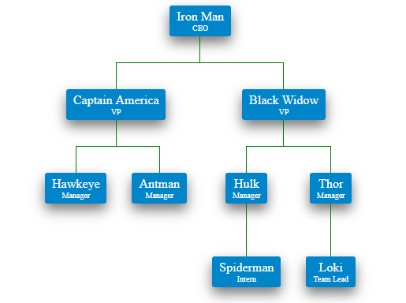

# Angular Org Chart

An Angular 2+ library for displaying organization charts, published to npm as [`angular-org-chart`](https://www.npmjs.com/package/angular-org-chart). It's a lightweight, pure-TypeScript component with click-to-expand/collapse nodes and CSS-customizable styling, built for Angular projects.

## Tech Stack

- Angular 6 (CLI workspace + `ng-packagr` library)
- TypeScript, SCSS
- Karma + Jasmine (unit tests), Protractor (e2e)

## Prerequisites

- Node.js compatible with Angular CLI 6 (Node 8.x or 10.x recommended)
- npm
- Angular CLI 6: `npm install -g @angular/cli@6`

## Project Structure

```
src/app/modules/org-chart/
  org-chart.module.ts          - OrgChartModule (public entry point)
  orgData.ts                    - OrgData interface (chart data shape)
  org-chart/org-chart.component.* - root chart component
  entity/entity.component.*      - individual node/box rendering
public_api.ts                   - library's public API surface (used by ng-packagr)
ng-package.json                 - ng-packagr config for building the publishable library
```

## Installation (developing this repo)

```
npm install
```

## Running the demo app

```
npm start
```

Serves the Angular CLI app shell (used to develop/demo the chart) at `http://localhost:4200`.

## Build

```
npm run build
```

To package the library for npm distribution:

```
npm run packagr
```

## Test

```
npm test     # unit tests via Karma
npm run e2e  # end-to-end tests via Protractor
```

## Using the published package

### Installation
```
npm install angular-org-chart --save
```

### Add the dependency in your module

Add `OrgChartModule` to your imports:

```ts
import { BrowserModule } from '@angular/platform-browser';
import { NgModule } from '@angular/core';
import { OrgChartModule } from 'angular-org-chart';
import { AppComponent } from './app.component';

@NgModule({
  declarations: [
    AppComponent
  ],
  imports: [
    BrowserModule,
    OrgChartModule
  ],
  providers: [],
  bootstrap: [AppComponent]
})
export class AppModule { }
```

### Formatting the data

The chart requires data in this shape:
```
{
  name: "Element Value",
  type: 'Element Type',
  children: []
}
```

Example component:

```ts
import { Component } from '@angular/core';
import { OrgData } from 'angular-org-chart/src/app/modules/org-chart/orgData';

@Component({
  selector: 'app-root',
  templateUrl: './app.component.html',
  styleUrls: ['./app.component.css']
})
export class AppComponent {
  orgData: OrgData = {
    name: "Iron Man",
    type: 'CEO',
    children: [
      {
        name: "Captain America",
        type: 'VP',
        children: [
          { name: "Hawkeye", type: 'manager', children: [] },
          { name: "Antman", type: 'Manager', children: [] }
        ]
      },
      {
        name: "Black Widow",
        type: 'VP',
        children: [
          {
            name: "Hulk",
            type: 'manager',
            children: [
              { name: "Spiderman", type: 'Intern', children: [] }
            ]
          },
          {
            name: "Thor",
            type: 'Manager',
            children: [
              { name: "Loki", type: 'Team Lead', children: [] }
            ]
          }
        ]
      }
    ]
  };
}
```

### Using the org chart in a template

```html
<angular-org-chart id="orgChartId" [data]="orgData"></angular-org-chart>
```

Note that `id` is required if you want to customize the CSS — the styles for boxes and connector lines must be scoped to that `id` or they won't apply.

## Personalized CSS

For connector lines:
```css
#orgChartId .org-chart-entity-border {
	border-left: 1px solid green;
	border-top: 1px solid green;
}
```
For spacing between levels:
```css
#orgChartId .org-chart-entity-connector {
	height: 2em;
}
```
For box styling:
```css
#orgChartId .org-chart-entity-box {
	align-items: center;
    border: 1px solid blue;
    background-color: blue;
    border-radius: 3px;
	box-shadow: 0 .5rem 1rem #777!important;
}
```

### Example


## Features

* Expand/collapse on click
* Custom styles
* Maintained and lightweight code

## Upcoming features

* Option to turn off default expand/collapse on click
* Icon support
* More freedom for custom styles
* Expand/collapse-all feature

## Authors

* **Shrey Kumar Jain** - *Initial work* - [Blog](https://researchershrey.wordpress.com/)
